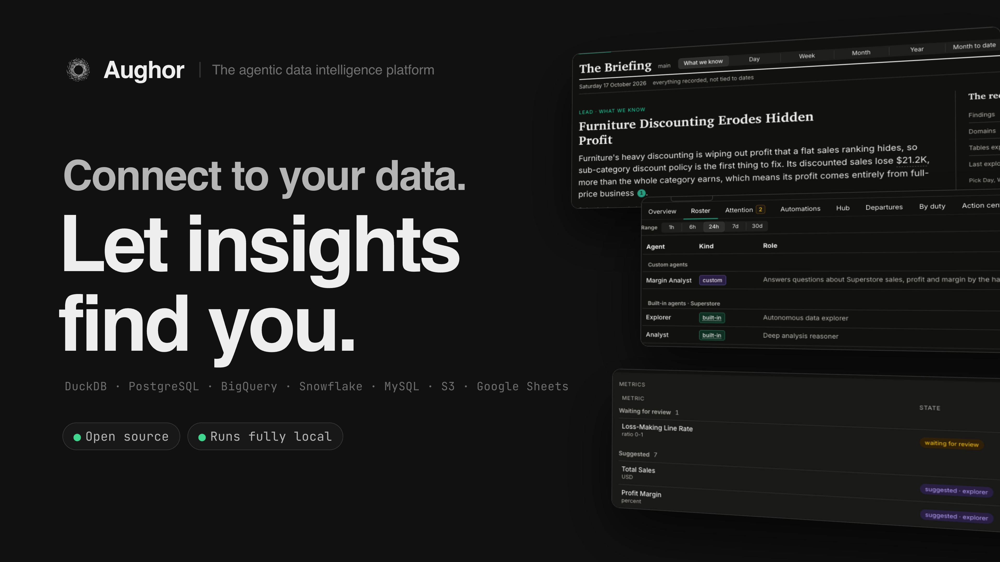
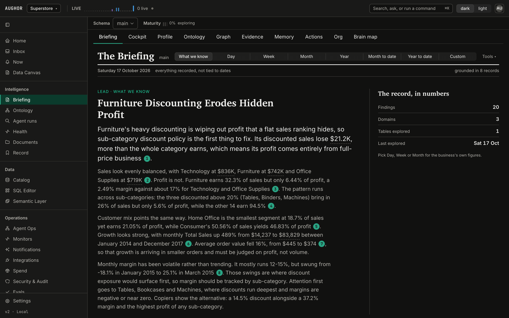

<div align="center">
  
  <h1>Aughor</h1>
  <p><strong>The agentic data intelligence platform.</strong></p>
  <p><em>Connect to your data. Let insights find you.</em></p>

  <p>
    <a href="https://github.com/sidhasadhak/aughor/actions/workflows/ci.yml"></a>
    <a href="LICENSE"></a>
    
    
  </p>

  <p>
    <a href="#quick-start"><strong>Quick start</strong></a> ·
    <a href="#pick-your-models"><strong>Models</strong></a> ·
    <a href="#whats-inside"><strong>What's inside</strong></a> ·
    <a href="ROADMAP.md"><strong>Roadmap</strong></a> ·
    <a href="FEATURES.md"><strong>Features</strong></a>
  </p>

  <a href="#the-96-second-tour"></a>
  <p><a href="#the-96-second-tour"><strong>▶ Watch the 96-second tour</strong></a> — filmed on the Superstore sample data, every screen live</p>
</div>

---

Aughor connects to your warehouse and **keeps learning from it**. It explores the data on its own, learns what the business is, writes the metrics into a governed semantic layer for you to review and approve, and briefs you with every number cited. When you do ask — in plain English, in the SQL editor or as an analyst agent you built — the answer comes with **evidence, guards and a receipt**.

> **The thesis:** most AI data tools are query wrappers — you ask, they translate. Aughor explores your data in the background, forms a business ontology, and is engineered so the numbers it reports are **trustworthy, not just plausible**: deterministic guards sit between the model and every figure you see.

- 🔭 **It explores on its own.** Connect a warehouse and it starts learning — no prompts — keeping a frontier of what it has already covered and re-exploring as schema and data move. An interrupted run says so and offers to continue.
- 🧠 **It learns the business, then writes the metrics.** A business profile inferred from the data proposes the metrics that matter. You customise one into a draft, see the checks before you decide (what it changes, whether it runs, what it declares, what could be compared), and approve it through an approval gate.
- 📰 **It briefs you.** A morning paper per dataset: the lead story, the trends, the gaps and what to decide today — every figure cited and one click from the query behind it, for what is known or for a day, week, month or year.
- 🤖 **Agentic, not agreeable.** Ask a hard question and it plans, runs the queries and tests your hunch before it agrees with it — a deep, multi-phase run you can steer, or a quick straight answer.
- 🛡 **It refuses to be confidently wrong.** Engine-driven trust guards (grain, fan-out, numeral grounding, premise validation, adversarial refutation) run on the answers; a statement that would change data is refused before it runs, and every query is on the record in Security & Audit.
- 📒 **It keeps a record.** Inquiries, decisions, missions, claims and corrections: what is established, what was chosen and what became of it, and what the platform was wrong about.
- 🏭 **It adapts to your industry.** An airline gets load-factor and on-time performance; a retailer gets AOV and return rate — an industry pack guides, the data decides.
- 🔌 **It runs fully local.** Your warehouse, your models — nothing has to leave your machine.

### The 96-second tour

https://github.com/user-attachments/assets/0f66b544-4d82-4059-9e08-2153fa4def5e

<sub>Filmed on the Superstore sample data, every screen live · <a href="docs/readme/aughor-launch.mp4?raw=true">full quality (19 MB)</a></sub>

<p align="center">
  
</p>

## Quick start

**macOS / Linux**

```bash
curl -LsSf https://raw.githubusercontent.com/sidhasadhak/aughor/main/install.sh | sh
```

**Windows**

```powershell
powershell -ExecutionPolicy ByPass -c "irm https://raw.githubusercontent.com/sidhasadhak/aughor/main/install.ps1 | iex"
```

The installer asks once which industries Aughor is for (airline, food delivery, logistics,
manufacturing, retail and e-commerce, SaaS). Press Enter to keep them all: each connection's industry
is then detected from its data. To answer without being asked, add `--industries retail,saas` (or
`all`, or `none`) — `curl … | sh -s -- --industries retail`, or set `AUGHOR_INDUSTRIES` — and change it
later in **Settings → Organization** or with `aughor industries`.

Next time, run `aughor`.

### What it installs, and where

Nothing needs to be installed first — not even Git — and nothing asks for admin.

| | |
|---|---|
| **The checkout** | `~/aughor` (`AUGHOR_DIR` to change it). A `git clone` when this computer has a working Git, otherwise the same code as a downloaded snapshot. |
| **uv** | Only if missing, from `astral.sh`. |
| **Python 3.11** | Through `uv python install`, into uv's own store. |
| **Node.js** | This computer's, if it is 20.9 or newer. Otherwise a private Node 24 into `.aughor/node/`, verified against nodejs.org's published SHA-256 before anything is unpacked. |
| **The `aughor` command** | Into uv's command folder, which is already on `PATH`. No shell startup file is edited. |
| **Logs** | `.aughor/logs/` inside the checkout. A failed step prints the end of its log and what to do next. |

**Disk.** About 2 GB after a full install — measured on macOS: ~1 GB for the Python
environment and ~1 GB for the web app's packages, plus the checkout and a web build. Re-running
the installer only redoes what changed.

**Platforms.** macOS and Linux through `install.sh`; Windows through `install.ps1`, which also
runs from Command Prompt. CI performs a real install on all three whenever the installer or
what it installs changes. WSL2 is expected to behave as Linux does, but nobody has measured
it, so this page does not claim it.

### Running it again, updating, uninstalling

```bash
aughor doctor           # uv, Python, Node, both ports, the state dir, PATH, the model
aughor update           # fetch and fast-forward, then re-run the install steps
```

`aughor update` refuses rather than guesses: a checkout with local commits the remote does not
have is **never** rewound, and local edits outside `data/` stop it with the files named.
Changes inside `data/` never block it — that is state the app writes. A snapshot install has
no remote to update from, so it tells you to re-run the installer, which leaves your data alone.

To **uninstall**, delete the checkout (`~/aughor`) and the `aughor` launcher in uv's command
folder — `aughor doctor` prints its path. Your connections, history and receipts live under
`data/` inside the checkout, so copy that out first if you want to keep them.

### Installing without being asked anything

```bash
curl -LsSf …/install.sh | sh -s -- --industries all --no-start
```

| | |
|---|---|
| `--industries retail,saas` \| `all` \| `none` | Answer the one question up front (or set `AUGHOR_INDUSTRIES`). |
| `--no-start` | Install only; do not start or open a browser. |
| `AUGHOR_DIR=/some/folder` | Install somewhere other than `~/aughor`. |

### When it will not install

**Windows Defender flags `uv.exe`.** A known false positive. Exclude uv's folder, or install uv
yourself first from `astral.sh`, then run the installer again.

**A corporate proxy.** If a download fails with a certificate error, the installer now says so
and prints the three variables to set. TLS-inspecting proxies re-sign connections, and Python,
Node and curl each need their own pointer at your organisation's CA bundle:

```bash
export CURL_CA_BUNDLE=/path/to/ca-bundle.pem
export SSL_CERT_FILE=/path/to/ca-bundle.pem
export NODE_EXTRA_CA_CERTS=/path/to/ca-bundle.pem
```

**A flaky network.** Downloads retry three times, and a throttled GitHub falls back to a
blobless clone and then to a snapshot. If it still fails, the log named in the error has the
underlying reason.

## Pick your models

Aughor **ships no default model** — nothing is assumed about another vendor's catalogue, so you name one before your first question. The one route to a model is **Settings → Models** in the web UI: pick a backend, and the picker lists what that backend actually serves (plus your custom entries). Backends: **Ollama · LM Studio · Groq · Together · Anthropic · Gemini · OpenRouter** (OpenRouter and Gemini both have free tiers).

- **Three roles, independently pluggable:** SQL generation (`coder`), report synthesis (`narrator`), and the fast interpret sub-tier (`fast`) each resolve on their own — run a fast structured model for SQL and a stronger one for prose.
- **A fallback you choose and watch:** pick a fallback backend/model in Settings; when the primary fails, the chain fails over — and since the run narrates its hops in the chat stream, a failing primary can't hide behind a healthy fallback. Pin the chain order with `AUGHOR_FALLBACK_BACKENDS` when you need to.
- **Env is the fallback layer**, not the primary config: `cp .env.example .env` and set `AUGHOR_BACKEND` + a key for headless/deployment setups; Settings wins when both exist.
- The `aughor up` boot summary shows whether a backend and model are configured (no network call — it can't tell you the backend is *reachable*). The API serves without an LLM; questions fail until one answers.

Minimal fully-local `.env`:

```env
AUGHOR_BACKEND=ollama
AUGHOR_CODER_MODEL=qwen2.5-coder:14b
AUGHOR_NARRATOR_MODEL=qwen2.5-coder:14b
OLLAMA_BASE_URL=http://localhost:11434/v1
AUGHOR_EMBED_MODEL=nomic-embed-text
```

## What's inside

One corpus of intelligence behind many surfaces — the depth, mechanisms, and trade-offs live in **[FEATURES.md](FEATURES.md)**.

**Intelligence**
- **Briefing** — a morning paper per dataset: the lead story, trends, gaps and "decide today", conclusion-first and impact-ranked, every number cited and one click from its query; for what is known or for a period, gated on the governed metric layer before anything can headline. Ask a follow-up and it stays in the Briefing's dataset and period.
- **Home, Inbox and Now** — Home prepares a desk from what is on record and takes a question; Inbox holds what deep analyses recommended and what became of each; Now is what needs you this week — sent, waiting, held, corrected.
- **Data Canvas** — **Agent mode is the default**: a deep, multi-phase run with a plan you can edit, streamed progress, and interrupt-anytime input; Quick mode for a straight answer. Runs are supervised jobs that survive a closed tab and reattach, every conversation restores from History, and you can answer as one of your own agents.
- **Deep analysis** — intake → baseline → decompose → dimensional → synthesize, with premise validation, period-over-period decomposition anchored to the data's real window, loss-intent and multi-lens scans, and a report that is honest by construction (one canonical grain, consistent units, charts that match their prose).
- **Autonomous exploration** — phase-structured, frontier-incremental, grounded in the actual schema by construction; findings prove themselves with confirming queries and land in the Evidence Ledger.
- **Semantic layer & governed metrics** — metrics proposed from the business profile, customised into drafts, reviewed against their checks and approved through an approval gate, each dated and marked measured; one precedence-ranked contract that chat, deep analysis and the explorer all read.
- **Ontology** — auto-built and human-editable with override-wins semantics: entities, relationships, lifecycles, and the processes and actions on them, versioned in releases and compiled into docs.
- **Record** — five ledgers (Inquiries, Decisions, Missions, Claims, Corrections), editable: add a hypothesis, mark a claim wrong, reopen a decision.
- **Trust guards** — the layer that separates Aughor from a plausible demo: grain/fan-out/numeral/premise/refutation guards, one shared SQL-safety pipeline across every mode, earned-confidence computed (never asserted), snapshot-pinned receipts.
- **Adaptive temporal scope** — four tiers from activity-anchored recency to a cost governor for TB-scale warehouses.

**Data**
- **Connectors** — DuckDB · MotherDuck · PostgreSQL · **BigQuery** (run live in production against a real warehouse) · Snowflake · MySQL · SQLite · Exasol · Trino · local upload (CSV/Parquet/Excel) · S3 · Google Sheets · Stripe / HubSpot / Salesforce · Confluence / Notion, and federated queries across them. Credentials Fernet-encrypted at rest; a per-dialect capability contract keeps generated SQL runnable on each engine.
- **SQL Editor** — SQL or a visual composer; type `/ask` and a question and it writes the SQL; every statement is checked by the guards before it runs; results, charts, and open-in-editor from any answer.
- **Catalog & Documents** — browsable schema intelligence and glossary; a searchable corpus of the documents your agents read.

**Operations**
- **Agents & Agent Ops** — build your own analyst agents (instructions, a connection, the documents they read) and ask as them; a control room with an overview, the roster, what needs attention, automations and an action centre. Approvals are risk-graded and audited.
- **Monitors, notifications & integrations** — findings become monitors; alerts deliver to Slack, webhooks and Jira on guarded evaluations; Slack and Microsoft Teams bots, where "that's wrong" becomes a correction.
- **Spend** — usage and model cost by run, caps that stop a run and open a budget editor, and a governance feed.
- **Security & Audit** — every query checked and recorded, by person or agent: what was blocked, what was flagged, what was masked, and the gate map.
- **Evals** — suites, runs and experiments in the app; golden-set, Spider 2 and ablation harnesses in `evals/`.
- **MCP server** — Aughor's governed answers as [MCP](https://modelcontextprotocol.io) tools (`python -m aughor.mcp`): Claude Desktop / Claude Code / Cursor get a verified answer with a Trust Receipt, not raw SQL. An administrator can also open doors through which outside agents read the ontology and propose its actions.
- **Agent skill & catalog** — [`SKILL.md`](SKILL.md) teaches a coding agent the governed workflow; [`llms.txt`](llms.txt) and a machine-readable connector catalog ([`aughor/connectors/catalog.json`](aughor/connectors/catalog.json), secrets flagged) make the platform legible to tools.
- **Security & RBAC** — fail-closed SQL safety gate, read-only Postgres, SSRF allowlist, prompt-injection fencing; flag-gated org tenancy with a viewer ⊂ analyst ⊂ owner ladder, row-level policy compiled into every connector's WHERE, and row and property security on the ontology.

## Stack

| Layer | Technology |
|---|---|
| Backend | Python 3.11+, FastAPI, LangGraph |
| Frontend | Next.js 16 (App Router, Turbopack), TypeScript, Tailwind, Radix Themes |
| Analytics | DuckDB, PostgreSQL, BigQuery |
| Charts | Vega-Lite — one grammar for screen and PDF/PPTX export |
| LLM runtime | Ollama · LM Studio · Groq · Together · Anthropic · Gemini · OpenRouter, per-role, with a chosen fallback chain |
| Statistics · SQL | scipy, numpy · SQLGlot |
| Observability | OpenTelemetry (GenAI semantic conventions) — point `AUGHOR_OTLP_ENDPOINT` at Jaeger/Tempo/Langfuse; unset = no export |
| State · Packaging | SQLite (history, registry, evidence, audit) · uv |

## Project structure

```
aughor/
├── aughor/
│   ├── agent/        # LangGraph investigative loop + phase prompts
│   ├── briefing/     # The Briefing — periods, ranges, the morning paper
│   ├── canvas/       # Data Canvas — scoped workspaces and their answers
│   ├── connectors/   # DuckDB, Postgres, BigQuery, Snowflake, Stripe, …
│   ├── evidence/     # Evidence ledger — claims, confidence, feedback
│   ├── explorer/     # Background exploration, grounding, cost/watermark
│   ├── kernel/       # Jobs, ledger, flags, metering — the supervision spine
│   ├── mcp/          # The MCP server and its doors
│   ├── ontology/     # Ontology builder, enricher, validator, store
│   ├── record/       # Inquiries, decisions, missions, claims, corrections
│   ├── routers/      # FastAPI domain routers (async, SSE)
│   ├── security/     # SQL safety gate, auth, credentials, audit
│   ├── semantic/     # Glossary, metrics, compiler, canonical resolver
│   ├── sql/          # SqlWriter, shared safety pipeline, guards
│   ├── tools/        # schema-linker, data catalog, profiler, stats
│   └── …             # 66 packages in all
├── evals/            # golden-set, Spider 2 and ablation harnesses
├── web/              # Next.js app — components, lib, design tokens
├── docs/             # architecture, roadmaps, audits
└── tests/            # pytest suite — hermetic, offline, failure-path + chaos
```

## Configuration

`.env` at the repository root; [`.env.example`](.env.example) is the full reference. Essentials:

| Variable | Default | What it does |
|---|---|---|
| `AUGHOR_BACKEND` | `ollama` | `ollama` \| `lmstudio` \| `groq` \| `together` \| `anthropic` \| `gemini` \| `openrouter` |
| `AUGHOR_CODER_MODEL` / `AUGHOR_NARRATOR_MODEL` | — | Per-role models (Settings → Models overrides env) |
| `AUGHOR_FALLBACK_BACKENDS` | Settings choice | Pin the failover chain order (`none` disables it) |
| `AUGHOR_DEFAULT_POSTGRES_DSN` | — | Pre-loads a Postgres connection on startup |
| `AUGHOR_QDRANT_PATH` | `qdrant/` in the state directory | Embedded vector store for semantic search (`semantic` extra) — in-process, no server |
| `AUGHOR_QDRANT_URL` | — | Set to pin a Qdrant *server* instead of the embedded store (e.g. `http://localhost:6333`) |
| `AUGHOR_PUBLIC_API_URL` | — | This API's public HTTPS origin, when it has one. It turns a Slack install into a button (the OAuth callback), gives a Teams bot its messaging endpoint, and puts absolute URLs on an agent's doors and A2A card. Unset, those say what is missing instead of guessing. |
| `AUGHOR_MODEL_PRICES` | — | Rates for a provider whose API publishes none, so spend tiles say a number instead of **unpriced**: `provider:model=input/output@date`, USD per 1M tokens, `;`-separated. Google publishes no price endpoint; for the default install's model the list price carried by the aggregators on 2026-09-15 was `gemini:gemini-3.1-flash-lite=0.25/1.50@2026-09-15` — re-check it, the date is part of the claim. A declared rate outranks the catalogue; the product itself ships no model id. |

**Before exposing Aughor beyond `localhost`,** read [SECURITY.md](SECURITY.md) — the defaults assume a trusted single-user machine (`AUGHOR_API_KEY` gates requests when set; `AUGHOR_CORS_ORIGINS` scopes browsers; `AUGHOR_SECRET_KEY` encrypts stored credentials).

### Optional extras

```bash
uv sync --all-extras                      # everything (recommended for development)
uv sync --extra export --extra semantic   # or pick individually
uv sync                                   # serving core only
```

Each `uv sync` leaves exactly the extras it names and removes any others — so name every extra you want in one command. The installer syncs them all.

| Extra | Adds | Without it |
|---|---|---|
| `export` | PDF / PowerPoint reports | Export answers **501**, naming the extra |
| `semantic` | Semantic search over past analyses (embedded Qdrant — no server needed) | Reads return no hits, writes no-op |
| `fastread` | Faster bulk table reads (polars) | Falls back to DuckDB automatically |
| `warehouse` | Snowflake, BigQuery, MySQL, Exasol, Trino | Those connectors are unavailable |
| `crm`, `cloud-storage`, `knowledge-sync` | Stripe/HubSpot/Salesforce, Azure Blob, Confluence/Notion | Those connectors are unavailable |
| `observability`, `evals` | OTel/Langfuse export, eval harnesses | Tracing and harnesses unavailable |

Every extra degrades with a message naming the install command, and a footprint test keeps heavy packages off the API's import path. Sizes drift with platform — measure rather than trust: `uv run python scripts/measure_footprint.py --compare`.

## Project status

**Alpha.** No tagged release; `main` is the only supported branch.

What is real today: **12,000+ backend tests**, run by CI on Python 3.11 for every change and on 3.11–3.13 weekly; `ruff` at a zero baseline; CI additionally gates codegen drift for the typed API client. The frontend typechecks under `strict`, and CI runs six focused lint gates, two bundle-drift checks and a production build; its **2,400+ vitest tests** (pure-logic and jsdom component projects) run locally, not in CI. What is not: `eslint` reports pre-existing findings and is not a CI gate; there is no container image (`docker-compose.yml` brings up Qdrant, MLflow and Jaeger); deployment beyond a local machine and a Vercel data plane is young.

## Roadmap, contributing, security

- **[ROADMAP.md](ROADMAP.md)** — prioritized backlog and shipped milestones · **[FEATURES.md](FEATURES.md)** — the living reference, by capability (mechanisms and files) · **[docs/PLATFORM_ARCHITECTURE.md](docs/PLATFORM_ARCHITECTURE.md)** — tenancy, catalog, and the control/data-plane split.
- Contributions welcome — start with **[CONTRIBUTING.md](CONTRIBUTING.md)**; the load-bearing conventions (default-off flags, guards that ship with a test proving they fire, never raising a ratchet baseline) are documented there. [Code of Conduct](CODE_OF_CONDUCT.md) applies.
- Report vulnerabilities **privately** — see [SECURITY.md](SECURITY.md).

## Acknowledgements

[LangGraph](https://github.com/langchain-ai/langgraph) · [DuckDB](https://duckdb.org) · [SQLGlot](https://github.com/tobymao/sqlglot) · [FastAPI](https://fastapi.tiangolo.com) · [Next.js](https://nextjs.org) · [Vega-Lite](https://vega.github.io/vega-lite/) · [DM Sans](https://github.com/googlefonts/dm-fonts) (SIL OFL 1.1). The human-command surface is shaped by Palantir Foundry's AI FDE ideas; the trust-and-verification framing owes a debt to MotherDuck's writing on governed semantic layers.

## License

[Apache License 2.0](LICENSE). Redistributed third-party assets (the DM Sans font files) carry their own licenses — see [NOTICE](NOTICE).
